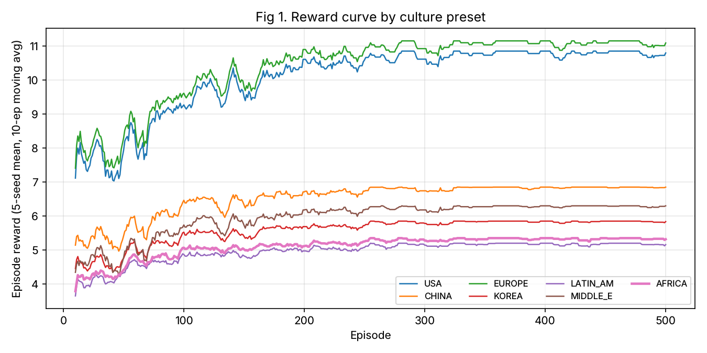
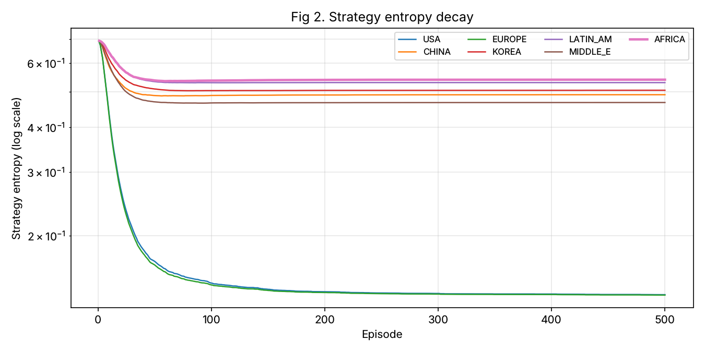
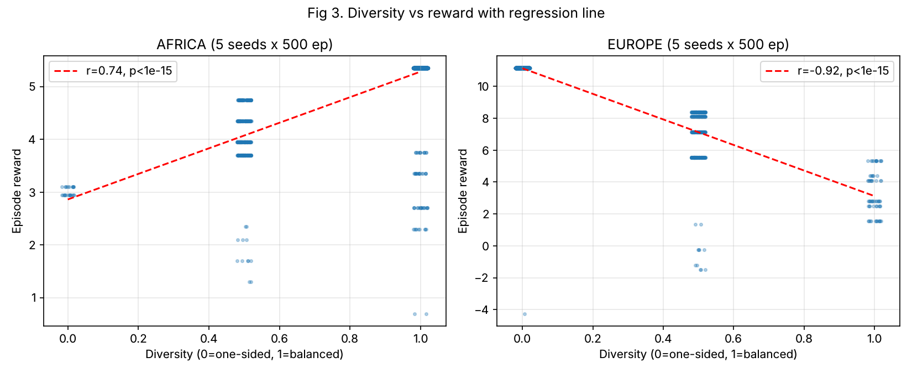

# [T?] Week 3 · 시뮬레이션 최종 분석 리포트 (AFRICA)

> student_package 템플릿(`docs/week3/final_report.md`) 기준. 슬라이드 기준 감사 보고서는 `audit.md` (같은 시나리오, 다른 하이퍼파라미터).
> 1·2·3·5절 수치와 그림은 코드가 만든 것 (Claude 작성, `logs/ai_usage_log.md` Entry #4·#6). **4절 가설 검증, 6절 재설계 결정, 7절 Reflection 은 팀이 쓴다.**
> ⚠️ 현재 7개 문화 모두 **강의 슬라이드 예시 가중치** (`rl/reference_presets.yaml`). 팀의 `presets/AFRICA.yaml` 이 들어오면 `python -m rl.workbook_protocol` 재실행 후 이 표를 갱신한다.

## 1. 실행 조건

| 문화권 | seeds | episodes | learning_rate | epsilon_init | epsilon_decay | epsilon_min | 보상 스케일 | 실행 로그 |
|---|---|---|---|---|---|---|---|---|
| USA | 42, 123, 2026, 7777, 31337 | 500 | 0.1 | 0.5 | 0.99 | 0.01 | Σw·r ×10 | `logs/w3/USA_seed<seed>_ep500.csv` |
| CHINA | 42, 123, 2026, 7777, 31337 | 500 | 0.1 | 0.5 | 0.99 | 0.01 | Σw·r ×10 | `logs/w3/CHINA_seed<seed>_ep500.csv` |
| EUROPE | 42, 123, 2026, 7777, 31337 | 500 | 0.1 | 0.5 | 0.99 | 0.01 | Σw·r ×10 | `logs/w3/EUROPE_seed<seed>_ep500.csv` |
| KOREA | 42, 123, 2026, 7777, 31337 | 500 | 0.1 | 0.5 | 0.99 | 0.01 | Σw·r ×10 | `logs/w3/KOREA_seed<seed>_ep500.csv` |
| LATIN_AM | 42, 123, 2026, 7777, 31337 | 500 | 0.1 | 0.5 | 0.99 | 0.01 | Σw·r ×10 | `logs/w3/LATIN_AM_seed<seed>_ep500.csv` |
| MIDDLE_E | 42, 123, 2026, 7777, 31337 | 500 | 0.1 | 0.5 | 0.99 | 0.01 | Σw·r ×10 | `logs/w3/MIDDLE_E_seed<seed>_ep500.csv` |
| AFRICA | 42, 123, 2026, 7777, 31337 | 500 | 0.1 | 0.5 | 0.99 | 0.01 | Σw·r ×10 | `logs/w3/AFRICA_seed<seed>_ep500.csv` |

- 규칙은 `app_reinforce.py`(교수님 앱)의 `SimpleEGreedyAgent` 와 같다: 1 episode = 시나리오 4건 각 1회 결정, episode 보상 = 4건 보상 합.
- 실행: `python -m rl.workbook_protocol` (약 40초) → CSV 35개, `logs/w3/summary.json`, 그림 3장.

## 2. 핵심 지표 (5개 seed 평균 ± 표준편차, 최종 100 episode)

| 문화권 | 최종 Reward | 최종 Entropy | Diversity | Pearson r (div–rew, 500 ep) | p-value (5 seed 중 최대) | p<0.05 seed 수 |
|---|---|---|---|---|---|---|
| USA | 10.776 ± 0.055 | 0.138 ± 0.002 | 0.012 ± 0.008 | -0.924 ± 0.033 | < 1e-15 | 5/5 |
| CHINA | 6.842 ± 0.008 | 0.491 ± 0.000 | 0.505 ± 0.009 | -0.296 ± 0.156 | 0.62 | 4/5 |
| EUROPE | 11.073 ± 0.055 | 0.137 ± 0.002 | 0.012 ± 0.008 | -0.925 ± 0.035 | < 1e-15 | 5/5 |
| KOREA | 5.833 ± 0.013 | 0.505 ± 0.001 | 0.504 ± 0.006 | -0.170 ± 0.232 | 0.5 | 2/5 |
| LATIN_AM | 5.168 ± 0.015 | 0.531 ± 0.001 | 0.504 ± 0.006 | -0.117 ± 0.108 | 0.81 | 3/5 |
| MIDDLE_E | 6.286 ± 0.017 | 0.467 ± 0.001 | 0.505 ± 0.009 | -0.462 ± 0.037 | < 1e-15 | 5/5 |
| AFRICA | 5.326 ± 0.013 | 0.541 ± 0.001 | 0.991 ± 0.005 | +0.741 ± 0.058 | < 1e-15 | 5/5 |

**지표 해석 (정의와 주의점)**

- Reward: 가중치마다 보상 스케일이 달라 문화 간 크기 비교는 '더 잘 학습했다'는 뜻이 아니다. 같은 문화 안에서 seed 간 SD 가 0.06 이하라 수렴은 안정적.
- Entropy: Q 값 softmax 의 엔트로피(자연로그, 최대 ln2 ≈ 0.693). 행동이 아니라 Q 값 차이로 계산하므로, 두 옵션 보상이 비슷한 시나리오(예: AF-FN-01 앱 기본 가중치 0.6 vs 0.8)가 있으면 수렴해도 높게 남는다. **낮다고 '옳다'는 뜻은 아니다.**
- Diversity: episode 안 4건의 A/B 균형. AFRICA 0.99 는 '망설임'이 아니라 **2건 A, 2건 B 로 확정**됐다는 뜻 (LB·SV → A, DP·FN → B). USA·EUROPE 0.01 은 4건 모두 B.
- Pearson r: 탐험(ε)으로 다른 옵션을 고른 episode 가 보상을 올렸는지 내렸는지를 본다. AFRICA r>0 은 균형 선택이 최적이라 탐험으로 한쪽에 쏠리면 보상이 떨어진다는 뜻이고, USA·EUROPE r<0 은 '전부 B' 가 최적이라 섞이면 손해라는 뜻. 상관은 인과가 아니고, ε 가 0.01 로 떨어진 뒤에는 diversity 변화가 거의 없어 r 은 초반 탐험 구간이 좌우한다.
- p-value: '상관이 0 이라는 가설 아래에서 이 정도 r 이 나올 확률'. n=500 episode 라 작은 r 도 유의해지므로 효과 크기(r)와 함께 읽는다. CHINA·KOREA·LATIN_AM 은 seed 에 따라 유의/비유의가 갈렸다(최대 p 0.5~0.8).

**문화 간 유의차**: 최종 Reward 일원분산분석 F = 31,970.752, p = 2.4e-52. 다만 보상이 결정적이고 seed 분산이 거의 없어 차이는 '가중치가 다르면 보상 숫자가 다르다'를 확인할 뿐, 문화 간 우열이나 실제 집단 차이를 뜻하지 않는다.

### 시나리오별 옵션 A 선택률 (최종 100 episode, 5 seed 평균)

| 문화권 | S1_afdp01 | S2_aflb01 | S3_affn01 | S4_afsv01 |
|---|---|---|---|---|
| USA | 0.00 | 0.01 | 0.01 | 0.01 |
| CHINA | 0.00 | 1.00 | 0.01 | 0.01 |
| EUROPE | 0.00 | 0.01 | 0.01 | 0.01 |
| KOREA | 0.00 | 0.01 | 0.01 | 0.99 |
| LATIN_AM | 0.00 | 0.01 | 0.01 | 0.99 |
| MIDDLE_E | 0.00 | 1.00 | 0.01 | 0.01 |
| AFRICA | 0.00 | 1.00 | 0.01 | 0.99 |

전체 옵션 A 선택률 21.7% (B 쏠림). 슬라이드 방식(`audit.md`, seed 0~4, ε 1.0→0.995)과 **28칸 최종 선택이 모두 같다** → 하이퍼파라미터보다 시나리오 보상 설계가 결과를 정한다.

## 3. 시각화

### Fig 1. Reward Curve (7문화권 오버레이, 5 seed 평균, 10 ep 이동평균)

### Fig 2. Strategy Entropy Decay (로그 스케일)

### Fig 3. Diversity vs Reward 산점도 + 회귀선 (AFRICA, EUROPE)

## 4. 가설 검증 (팀 작성)

> `docs/week1/culture_report.md` 의 H1~H3 를 그대로 옮기고, 위 표·그림의 수치로 판정한다.

| 가설 | 지지 / 기각 | 근거 지표 (수치, 그림 번호) | 해석 |
|---|---|---|---|
| H1 | | | |
| H2 | | | |
| H3 | | | |

## 5. Audit 노트 (Tech-Check)

### 5-1 재현성
- seed 고정 시 같은 결과: `tests/test_workbook_protocol.py` 가 AFRICA·KOREA·USA 3개 seed 를 다시 돌려 `logs/w3/*.csv` 와 보상·선택열이 같은지 CI 에서 확인.
- seed 간 표준편차: 최종 Reward SD 0.008~0.055, 시나리오별 최종 선택은 5 seed 모두 동일.
- 버전 고정: `requirements.txt` (Python 3.11, numpy 1.26.4, scipy 1.13.1, matplotlib 3.9.2, pyarrow 17.0.0 등). 슬라이드 방식 결과도 `tests/test_agent.py` 로 재현 확인.
- 남은 일: 제출 24시간 전 다른 PC 에서 새 clone → 설치 → `python -m rl.workbook_protocol` 재현 리허설.

### 5-2 편향
- 옵션 A 선택률 21.7%: 28칸 중 22칸이 B. 원인은 4개 시나리오 모두 B 의 보상 합이 크게 설계된 것(`docs/week2/scenario_review.md` 2-1). AF-DP-01 은 어떤 프리셋도 A 를 고르지 않는다.
- 극단 프리셋: moral 가중치가 큰 USA(0.40)·EUROPE(0.45)는 4건 모두 B. 'moral ↔ emotion/social' 대립 구조만 있어 차이가 과장된다.
- 스테레오타입 위험: 'AFRICA 는 CCTV 얼굴인식·위험한 검수 일자리를 받아들인다'로 읽힐 수 있다. 실제로는 예시 가중치와 우리가 정한 보상 숫자의 내적 결과다. 시나리오 4건이 모두 아프리카의 감시·노동·부채 문제라 부정적 프레이밍도 강화될 수 있다.

### 5-3 한계
- ε-greedy 단일 에이전트, 상태 전이 없는 bandit: 보상이 결정적이라 학습은 'R_A 와 R_B 중 큰 쪽 찾기'에 가깝다.
- 시나리오 4건, 모두 케냐·나이지리아: 통계적 일반화 불가, 54개국의 이질성 소거.
- 4프레임 축소: 생명·안전, 환경, 세대 간 공정 같은 축이 없다. 가중치 근거(Hofstede 1970년대~2015, WVS 2017~2022)의 시점·표본 한계.
- 다른 6개 문화 가중치는 다른 팀 조사가 아니라 강의 예시값.

### 5-4 비용·법적 리스크·설명가능성 (실서비스 가정)
- 비용: 학습 자체는 노트북 40초·Streamlit 무료 티어로 충분. 실제 비용은 시나리오 근거 조사·현지 검증(인터뷰, 번역)과 보상 값 합의에 드는 사람 시간이다.
- 법적 리스크: 실제 서비스가 '문화권별로 다른 윤리 판단'을 자동 적용하면 국적·출신에 따른 차별(예: 케냐 Data Protection Act 2019, 각국 차별금지 규정) 문제가 된다. 이 모델은 판단 도구로 쓸 수 없다.
- 데이터 편향: 보상 숫자를 학부 팀이 정했고 근거 기사도 영어권 매체 위주.
- 설명가능성: 결정은 R = Σw·r 로 완전히 설명된다. 대신 '왜 그 숫자인가'는 설명되지 않는다 — 설명 책임이 모델이 아니라 보상 설계자에게 있다.

## 6. 재설계(R) 제안

### 근거 데이터: AFRICA 가중치 민감도 (Claude 계산)

AFRICA 가중치의 한 축을 ±0.05 움직이고 정규화한 8가지 경우, 200 episode × 5 seed: **최종 선택이 바뀐 시나리오 없음** (`logs/w3/summary.json` → `sensitivity_AFRICA_pm0.05_200ep`).
→ 가중치 미세 조정으로는 결과가 거의 안 바뀐다. 결과를 움직이는 것은 시나리오 보상 벡터다.

### 후보 (팀이 1건 골라 실제 수정 → 200 episode 재검증 → 수치 기록)

| 후보 | 근거 | 예상 지표 변화 |
|---|---|---|
| AF-DP-01 보상 재조정 (A·B 보상 합을 비슷하게) | 7문화 모두 B, 자명한 정답 | (추정) DP 의 문화 간 Diversity 1/7 → 2/7, 전체 A 선택률 21.7% → 25~30% |
| B 가 moral 이 아닌 축에서 이기는 시나리오 1건 추가 (다른 지역) | 4건이 같은 대립 구조, 케냐·나이지리아 편중 | (추정) 전체 A 선택률 50% 쪽으로, USA·EUROPE 의 Diversity > 0 |
| 팀 AFRICA 프리셋으로 재실행 | 현재 예시값 | AFRICA 행 갱신, 민감도 결과상 선택 변화는 작을 것 |

| 실제 수정 내용 (팀) | 200 ep 재검증 결과 | 다음 스프린트 제안 |
|---|---|---|
| | | |

## 7. 성찰 (Reflection, 팀 작성)

> 슬라이드 4트랩(본질주의·과잉일반화·서열화·모델 초월화) 중 2개 이상, 자기 언어로. 근거표는 `audit.md` 마지막 절.

- 우리 결과가 "아프리카 사람은 이렇게 판단한다" 로 오독될 위험은 어떻게 방지할 것인가?
- 이 시스템을 실서비스에 적용한다면 Value-Check/Tech-Check 관점에서 무엇이 걸릴까?
- AI 사용 로그를 통해 우리 팀 사고 흐름이 어떻게 바뀌었는가?

(팀 작성)

---

작성일: 2026-__-__ / 리뷰어: ______ / Merge PR: #___

### 🔍 제출 전 최종 체크

- [x] seed 5개 이상 스윕
- [x] 지표 표(Reward/Entropy/Diversity/Pearson) 완성
- [x] 그림 3장 이상 저장
- [x] Audit 3필러(재현성·편향·한계) 각 1건 이상 + 비용
- [ ] 재설계 제안 1건 실행·재검증 (팀)
- [ ] 가설 검증 (팀)
- [ ] Reflection (팀)
- [ ] `logs/ai_usage_log.md` 최종 커밋
