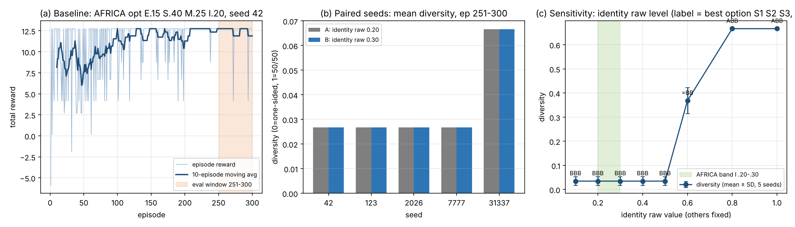

# W1 워크숍 (11주차): 시뮬레이터 탐색과 리플리케이션 실험

기준 자료: 강송희 교수 11주차 워크숍 PDF 2개 (「시뮬레이터 기본 개념과 리플리케이션 실험설계」 40장, 「시뮬레이션 실험설계와 가설검정」 입문 17장).
팀 가중치·범위: 팀 「AFRICA 최적설정」(2026-11-18) — AFRICA 근거 범위 S .30~.40 · I .20~.30 · E .15~.30 · M .15~.25 안에서 기본 시나리오 3개 기준 최적점 **E .15 · S .40 · M .25 · I .20**.

```bash
pip install numpy scipy matplotlib
python experiments/w1_workshop/run_w1.py        # 실행 결과 → out/
python experiments/w1_workshop/draw_structure.py # 구조도 (한글 폰트 NanumGothic 필요)
```

`sim.py`는 `app_reinforce.py`의 계산 규칙(ε-greedy, 보상 ×10, Q 갱신, ε 감소, 엔트로피, 다양성)을 화면 없이 그대로 옮긴 것이다.
교수님 입문 자료 부록의 KOREA 12시드 표(100판 vs 300판, 마지막 5판 평균)를 이 코드로 다시 계산하면 **24개 값이 모두 일치**한다 (`out/intro_professor_table_check.csv`). 즉 앱과 같은 결과를 낸다.

## 제출 파일 (워크숍 40장 기준)

| 제출물 | 파일 |
|---|---|
| 시뮬레이터 구조도 | `out/fig_simulator_structure.png` |
| 실험계획표 | 이 문서 1절 |
| 기준·비교 조건 CSV | `out/runs/*.csv` (실행별 원본), `out/experiment_log.csv` (로그 필수 필드), `out/paired_comparison.csv` |
| 결과 그림 + 리플리케이션 메모 | `out/fig_w1_result.png`, 이 문서 2~4절 |

## 1. 실험계획표 (실행 전에 고정, `run_w1.py` 상단 상수)

| 항목 | 내용 |
|---|---|
| 연구 질문 | 고정된 시나리오와 학습 설정에서 identity 가중치를 높이면 후반부 행동 다양성이 달라지는가? (워크숍 25장 질문을 AFRICA 설정에 적용) |
| 가설 | identity 가중치가 높은 조건(B)의 평균 다양성이 기준 조건(A)보다 낮다. (워크숍 25장 예시 가설) |
| 반례 (가설이 틀렸다고 볼 결과) | 5쌍 중 B−A 차이가 0 이상인 쌍이 과반이면 가설을 받아들이지 않는다. |
| 대립 설명 | 원시값을 바꾼 뒤 합=1로 정규화하므로 identity만 오르는 게 아니라 E·S·M도 같이 내려간다. |
| 독립변수 (바꾸는 것) | identity **원시값** A = 0.20, B = 0.30 (AFRICA 근거 범위 I .20~.30의 양 끝). 나머지 원시값 E .15 · S .40 · M .25 고정 |
| 정규화 후 실제 가중치 | A: E .150 S .400 M .250 I .200 / B: E .136 S .364 M .227 I .273 |
| 종속변수 (재는 것) | 에피소드 251~300 평균 행동 다양성 (보조: 같은 구간 평균 보상·엔트로피·A 선택 비율) |
| 통제변수 (같게 두는 것) | 기본 시나리오 3개(default-v1)와 순서, 에피소드 300, α 0.1, ε₀ 0.5, decay 0.99, ε 최소 0.01, 같은 코드 커밋, 같은 평가 구간 |
| 시드 | 42, 123, 2026, 7777, 31337 (5개, 두 조건에 똑같이 배정 = 대응 시드 비교) |
| 판정 규칙 | 시드별 Δᵢ = 다양성(B) − 다양성(A). Δ>0 상승, =0 동점, <0 하락. 동점은 따로 세고 결과표에 남김. 방향 검정은 하락 쪽 단측 부호검정, 유의수준 0.05. 파일이 없으면 "비교 불가"로 기록 |
| 동일 설정 재현 기준 | 같은 코드·설정·시드 42로 2번 실행, 행 수 동일 + 모든 수치 차이 ≤ 1e-9 |

## 2. 결과

### 2-1. 기준 실행 (AFRICA 최적, seed 42, 300 에피소드)

| 지표 (에피소드 251~300) | 값 |
|---|---|
| 평균 총보상 | 12.41 ± 1.70 (이론 최대 12.75) |
| 평균 엔트로피 | 0.042 (거의 확신) |
| 평균 행동 다양성 | 0.027 (50판 중 2판만 A가 섞임) |
| 최종 선택 S1/S2/S3 | B / B / B |
| 참고: 워크숍 23장 KOREA 기준(E.2 S.2 M.2 I.4) | 보상 9.03, 다양성 0.667, 엔트로피 0.264, 선택 A/B/B |

### 2-2. 동일 설정 리플리케이션 → **통과**
같은 설정·시드 42로 두 번 실행: 300행 = 300행, 최대 차이 0.0, 두 CSV의 SHA-256 앞 12자리 `4a4c631bbb19`로 완전히 같은 파일.

### 2-3. 비교 실험 (identity .20 vs .30, 대응 시드 5쌍)

| 시드 | A 다양성 | B 다양성 | Δ 다양성 | Δ 보상 | Δ 엔트로피 | 판정 |
|---|---|---|---|---|---|---|
| 42 | 0.027 | 0.027 | 0 | −0.77 | +0.055 | 동점 |
| 123 | 0.027 | 0.027 | 0 | −0.74 | +0.054 | 동점 |
| 2026 | 0.027 | 0.027 | 0 | −0.77 | +0.056 | 동점 |
| 7777 | 0.027 | 0.027 | 0 | −0.77 | +0.054 | 동점 |
| 31337 | 0.067 | 0.067 | 0 | −0.72 | +0.055 | 동점 |

집계: 계획 5쌍 = 상승 0 + 동점 5 + 하락 0 + 비교 불가 0. 차이가 난 쌍이 0개라 부호검정은 계산할 수 없다(p 정의 안 됨).
**결론: 가설("identity를 높이면 다양성이 낮아진다")은 지지되지 않았다.** 대신 보상은 5쌍 모두 B에서 낮고(평균 −0.75), 엔트로피는 5쌍 모두 B에서 높다(평균 +0.055).



### 2-4. 왜 다양성 차이가 정확히 0인가 (해석)
- 두 조건 모두 세 시나리오의 최선 선택이 B/B/B로 같다. 같은 시드면 탐색 때 뽑히는 난수 순서가 같으므로, 고르는 행동도 한 판도 다르지 않다. 후반부 다양성 0.027은 남은 탐색률(ε≈0.03~0.04)이 우연히 A를 고른 2판에서만 나온다.
- 즉 이 모형에서 후반부 다양성은 **최선 선택이 뒤바뀌는 임계점을 넘을 때만** 움직인다. 가중치를 조금 바꾸면 보상 크기(보상·엔트로피)는 변하지만 선택은 그대로다.

### 2-5. 사후 추가 분석 (실행계획에 없던 탐색적 분석 — 결론 근거가 아님)
- **민감도 분석** (`out/sensitivity_identity.csv`): identity 원시값 0.10~0.50까지 다양성 0.035로 같음(B/B/B). 0.60(정규화 0.43)에서 S1의 A·B 점수가 정확히 같아져 다양성 0.37로 뛰고, 0.80 이상(정규화 ≥0.50)에서 S1이 A로 바뀌어 0.667이 된다. 임계점은 AFRICA 근거 범위(I .20~.30) 밖에 있다.
- **입문 자료 방식(100판 vs 300판, 마지막 5판 평균)을 AFRICA 최적에 적용** (`out/intro_africa_100_vs_300.csv`): 시드 12개를 `default_rng(20261123)`으로 미리 뽑아 실행. 상승 7 · 동점 3 · 하락 2, 평균 차이 +1.07점, 단측 부호검정 p = 0.090 > 0.05 → 귀무가설 기각 못 함. 교수님 KOREA 예시(8·3·1, p = 0.0195)와 달리 AFRICA 설정에서는 "300판이 더 자주 오른다"를 이 표본으로 말할 수 없다.

## 3. 타당도와 한계
- **구성타당도**: 다양성 지표는 시나리오 3개라 한 판 값이 0, 0.667만 나온다(해상도 낮음). 네 프레임이 실제 아프리카 사람들의 윤리 판단을 대변한다는 근거는 이 실험에 없다.
- **내적타당도**: 정규화 때문에 identity만 바꾼 실험이 아니다(E·S·M도 9% 내려감). 다른 조건은 코드로 고정해 통제됨.
- **외적타당도**: 교수님 기본 딜레마 3개(트롤리 등)의 결과다. 아프리카 현지 딜레마나 문화권 전체로 일반화할 수 없다.
- **통계적 결론타당도**: 시드 5개, 전부 동점이라 검정이 성립하지 않음. "효과 없음"이 아니라 "이 범위·이 시나리오에서는 차이가 관찰되지 않음"이다.

## 4. 재실험 조건 (다음에 바꿔 볼 것)
1. 팀 AFRICA 시나리오 4개(W2)로 같은 실험 반복: 최선 선택이 B/A/A/A로 갈리는 설정이라 다양성이 움직일 수 있다.
2. 결과변수를 다양성 대신 후반부 평균 보상·엔트로피로 바꾸면 5쌍 모두 같은 방향의 차이가 있다(사전 등록 후 재검정 필요).
3. 다른 팀이 같은 계획표와 새 시드로 독립 반복 검증(replication).

## 5. 팀이 직접 채울 칸 (AI가 대신 쓰지 않음)
- [ ] 실행 전 팀 예상(손으로): identity를 올리면 다양성이 ______ 것이다. 이유: ______
- [ ] 결과를 우리 말로 한 문장: ______
- [ ] 이 결과가 "아프리카 문화"에 대해 말해 주지 **않는** 것 한 가지: ______
- [ ] 다른 팀에 독립 반복 검증을 부탁할 때 넘길 파일·설정 목록 확인: ______
